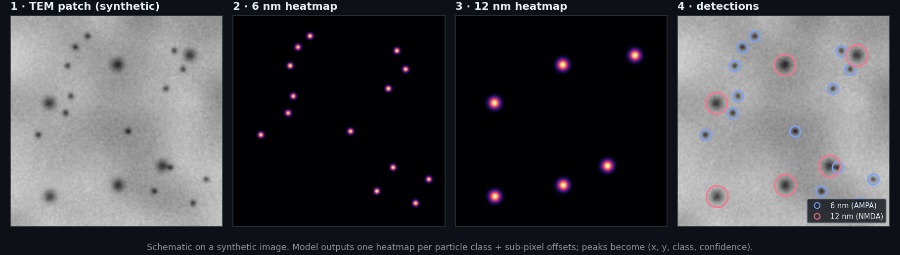
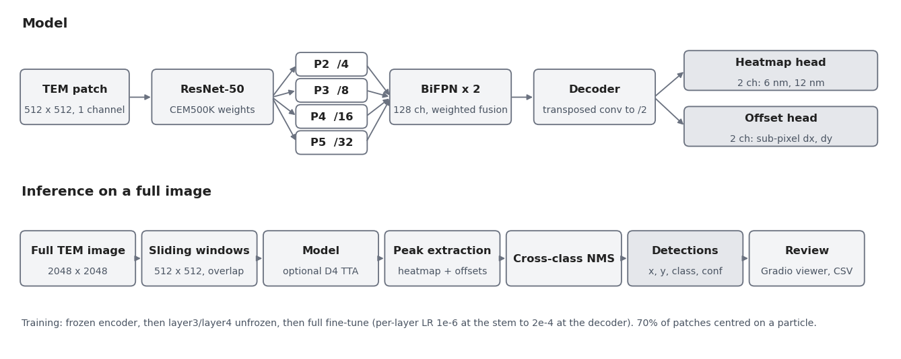

<div align="center">

# MidasMap

**Deep-learning detection of immunogold particles in electron microscopy, so neuroscientists stop counting receptors by hand.**

[](https://huggingface.co/AnikS22/MidasMap)




<sub>What the model produces, shown on a <b>synthetic</b> image: one heatmap per particle size, then peaks become labeled detections. The real TEM images belong to the lab that provided them and are not published here.</sub>

</div>

## What it does

To see where receptors sit at a synapse, neuroscientists tag them with tiny gold beads (**immunogold labeling**) and image the tissue with a transmission electron microscope (TEM). Here, 6 nm beads mark **AMPA** receptors and 12 nm beads mark **NMDA** receptors. Then someone counts every bead by hand, image after image. The beads are a few pixels wide in a 2048×2048 image, sit on noisy, textured tissue, and make up well under 0.1% of the pixels.

MidasMap does the counting: give it a TEM image and it returns the coordinate, class (6 nm or 12 nm) and confidence of every particle, plus a browser app to review the results.

## Highlights

| | |
|---|---|
| **F1 0.94** | Overall F1 of 0.943 in leave-one-image-out cross-validation (0.944 for 6 nm, 0.909 for 12 nm) |
| **Domain-specific pretraining** | ResNet-50 initialized from **CEM500K**, self-supervised on ~500k electron microscopy images, instead of ImageNet photos |
| **Built for tiny objects** | Stride-2 output and a 2-round **BiFPN**, so a 6 nm bead still covers enough pixels for clean peak extraction |
| **Handles extreme imbalance** | Penalty-reduced focal loss + particle-centered patch mining, where plain BCE collapses to "all background" |
| **Rigorous evaluation** | 10-fold leave-one-image-out CV with Hungarian matching at physical distance thresholds |
| **Shipped** | Trained weights on Hugging Face, a Gradio app, CLI, Docker image and SLURM scripts for HPC |
| **Tested** | Unit tests for heatmaps, losses, model shapes and matching |

## How it works

<div align="center">


<sub>Architecture and inference flow, drawn from <code>src/model.py</code> and <code>config/config.yaml</code>.</sub>
</div>

Training runs in three phases (`config/config.yaml`): frozen encoder, then unfreezing `layer3`/`layer4`, then a full fine-tune with per-layer learning rates from 1e-6 at the stem up to 2e-4 at the decoder. 70% of training patches are centered on a particle, 30% are random background.

## Results

Ten annotated TEM synapse images (2048×2048, 453 hand-labeled particles). Each fold trains on 9 images and tests on the held-out one. A prediction counts only if Hungarian matching pairs it with a ground-truth particle within 9 px (6 nm) or 15 px (12 nm).

| Class | F1 |
|---|---|
| 6 nm (AMPA) | **0.944** |
| 12 nm (NMDA) | **0.909** |
| Overall | **0.943** |

## Quick start

```bash
python -m venv .venv && source .venv/bin/activate
pip install -r requirements.txt

# trained weights from Hugging Face
huggingface-cli download AnikS22/MidasMap checkpoints/final/final_model.pth \
    --local-dir . --repo-type model

# browser app at http://127.0.0.1:7860
./scripts/run_local.sh

# or one image from the command line
python predict.py --image path/to/synapse.tif \
    --checkpoint checkpoints/final/final_model.pth \
    --output-dir results/predictions --conf-threshold 0.3
```

<details>
<summary><b>Training and evaluation</b> (needs annotated data)</summary>

Set `data.root` in `config/config.yaml`, then:

```bash
python scripts/download_cem500k.py                       # backbone weights
python evaluate_loocv.py --config config/config.yaml     # 10-fold LOOCV
python train_final.py --config config/config.yaml        # final model on all 10 images
pytest tests/
```

`slurm/` has the same steps as SLURM jobs for an HPC cluster. `Dockerfile` and `docker-compose.yml` run the app on a CUDA machine.
</details>

## Repo layout

| Path | What it is |
|---|---|
| `src/model.py` | ResNet-50 + BiFPN + heatmap/offset heads |
| `src/loss.py` | Focal loss and offset loss |
| `src/dataset.py` | Patch sampling with particle-centered crops |
| `src/ensemble.py`, `src/postprocess.py` | Sliding-window inference, TTA, NMS |
| `src/evaluate.py` | Hungarian matching and per-class F1 |
| `train_final.py`, `evaluate_loocv.py`, `predict.py` | Entry points |
| `app.py` | Gradio app (local and Hugging Face Space) |
| `scripts/visualize_*.py` | Explanatory diagrams (several plot illustrative values, not training logs) |
| `CODEBASE.md` | File-by-file notes |

## Limitations

- **Metrics provenance.** F1 values are from the original LOOCV evaluation; its `loocv_metrics.json` is not in this repo (an earlier summary figure shows 0.928 overall on 429 particles). Re-run `evaluate_loocv.py` to reproduce.
- **Small, single-source test set.** Ten images from one lab; not yet tested on other microscopes or labs.
- **Data not included.** The TEM images and annotations belong to the lab that provided them, which is also why the figures above use a synthetic image.
- **Demo Space.** The [Hugging Face Space](https://huggingface.co/spaces/AnikS22/MidasMap) is being restored; the local app works with the published weights.

## Credits

Built by Anik Sahai. Particle annotations were done by hand by the neuroscientists who provided the images. Backbone weights from CEM500K (Conrad and Narayan).

## License

MIT, see [LICENSE](LICENSE).
